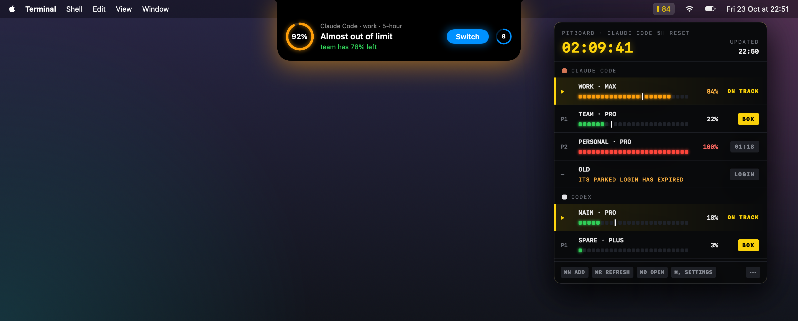
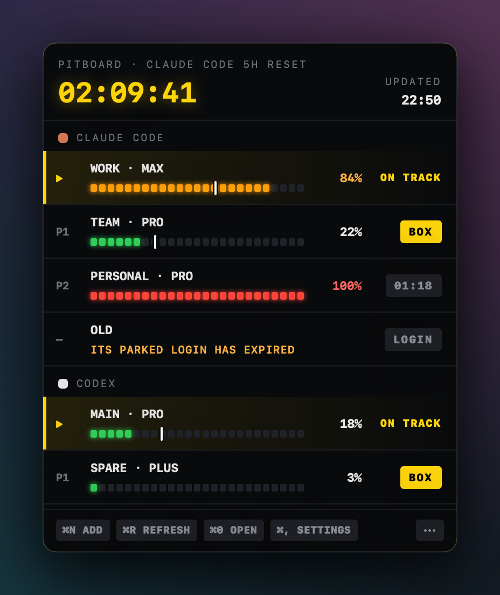
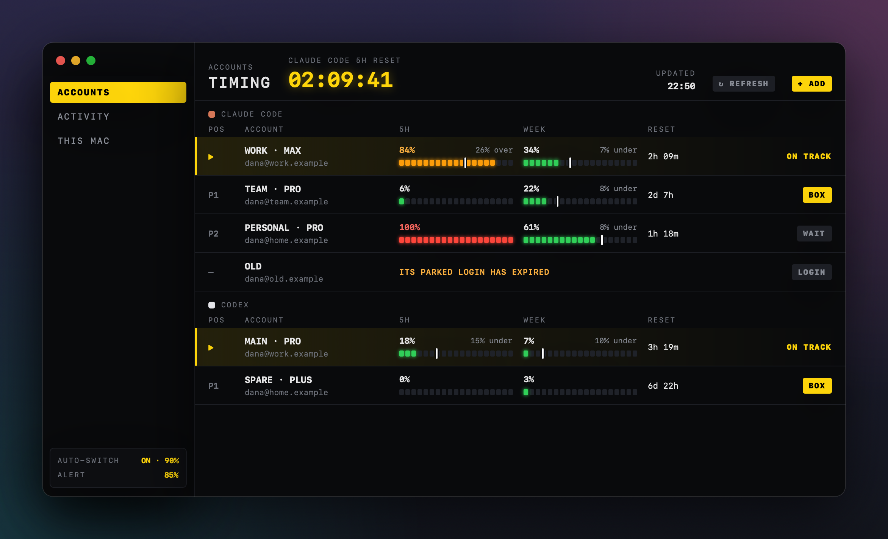
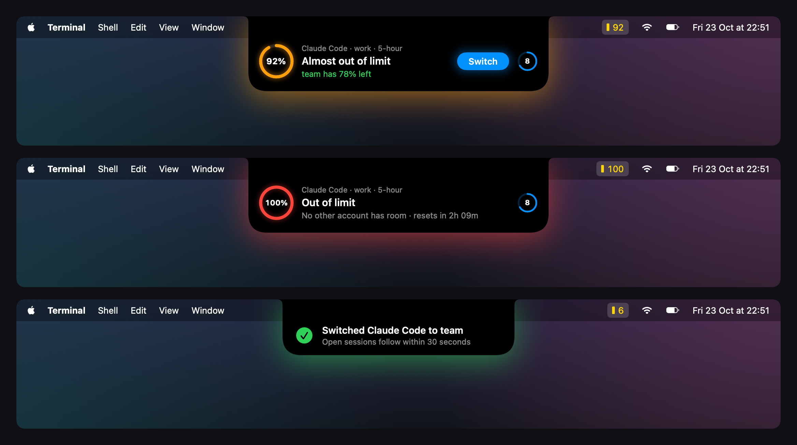

<div align="center">

# Pitboard · Pit Wall Edition

**Switch Claude Code, Codex and Claude Desktop between your own accounts,
and read every limit like an F1 timing tower.**

[](#build-and-install)
[](apps/macos)
[](crates)
[](LICENSE)
[](https://github.com/datlechin/pitboard)



</div>

Pitboard keeps the login of every account you are not using and swaps it in when you switch,
without signing out. Your history, settings and projects stay where they are, and
[open Claude Code sessions](https://docs.usepitboard.com/concepts/switching#open-sessions)
follow the switch with no restart.

This edition redesigns the **macOS app** around a pit wall: near-black boards, monospaced
figures, limits as rows of LEDs, and the yellow of a pit board for whatever can be pressed. It
adds an **island that grows out of the notch** when an account in use is about to run out, with
the account to switch to one click away. The Rust core, the command line and the Windows app
are upstream's, unchanged.

## What's new

| | |
|---|---|
| **Pit wall panel** | The menu bar item opens a timing tower instead of a menu. Each tool lists the account on track (▶) first, then the others as P1, P2… by how much they have left. Every limit is a row of LEDs with a white mark where an even pace would be. The header counts down to the next reset. |
| **Notch island alert** | When the account in use passes your threshold (85% by default), and again when it runs out, an island grows from the notch with an amber or red aura, a pulsing ring and a **Switch** button for the account with the most left. After the switch it shrinks to a green check. |
| **Timing tower window** | The accounts window shows the same tower with a column for each limit (5h, week), the pace ("26% over"), the reset and a BOX / WAIT / LOGIN action. The sidebar's foot shows auto-switch and alert settings at a glance. |
| **Settings › Limits** | A new **Limit alert** section: turn it on or off, pick the share (50–99%) and press **Show Preview** to see the island right away. |

## Screenshots

<table>
  <tr>
    <td width="34%" valign="top">
      
      <p align="center"><sub><b>Menu bar panel</b> · ▶ on track, P1/P2 ranked by room, BOX to switch</sub></p>
    </td>
    <td width="66%" valign="top">
      
      <p align="center"><sub><b>Accounts window</b> · one LED column per limit, pace, reset and action</sub></p>
    </td>
  </tr>
  <tr>
    <td colspan="2">
      
      <p align="center"><sub><b>Notch island</b> · almost out · out of limit · switched</sub></p>
    </td>
  </tr>
</table>

## How the limit alert works

| When | The island shows | Switch goes to |
|---|---|---|
| The account in use passes your threshold | Amber ring, "Almost out of limit", the best other account and what it has left | The account in the same tool with the most room |
| It reaches 100% | Red ring, "Out of limit", or when it resets if nothing else has room | Same, when one has room |
| Pitboard switched by itself | Green check, "Switched Claude Code to …" | — |

- Each crossing is said **once**; after the limit resets it can be said again.
- A small ring in the accent colour counts down 12 seconds (4 after a switch) before the island
  closes by itself. Hovering pauses it, and pressing the ring closes the island at once.
- **Switch** sends exactly what the account's BOX button sends, so it switches the same way and
  shows the same errors. Automatic switching stays the core's own setting
  (**Settings › Limits › Switch Claude Code automatically**).
- On a Mac without a notch the island drops from the middle of the menu bar.
- With **Reduce motion** on, it fades instead of springing and the ring does not pulse.
- Notification Center still gets Pitboard's run-out notices as before.

## Build and install

This edition is built from source. You need:

- macOS 14 or later (developed and tested on macOS 27.2, Apple silicon)
- Xcode with Swift 6.2 or later (tested with Xcode 27.1)
- Rust through [rustup](https://rustup.rs); `rust-toolchain.toml` picks the version
- [XcodeGen](https://github.com/yonaskolb/XcodeGen) 2.46 or later

```sh
git clone https://github.com/LeePham99x/pitboard.git
cd pitboard
rustup target add aarch64-apple-darwin x86_64-apple-darwin
brew install xcodegen

./apps/macos/scripts/build-app.sh                     # universal Pitboard.app, ad-hoc signed
ditto apps/macos/build/Pitboard.app /Applications/Pitboard.app
```

Then open **Pitboard** from Applications. The first time, macOS asks whether Pitboard may use
the login Claude Code keeps in your keychain; allow it.

> [!NOTE]
> A build from source is signed ad-hoc and carries no updater, so it never updates itself.
> To update, pull and build again.

### Develop

```sh
./apps/macos/scripts/build-xcframework.sh --fixture   # the Rust core and its Swift bindings
swift test --package-path apps/macos                  # the app's tests, without starting it
```

To try the app without touching your real logins, run the debug build in a fixture with
throw-away homes, as [Run the debug build](CONTRIBUTING.md#run-the-debug-build) explains:

```sh
home=$(mktemp -d)
PITBOARD_FIXTURE=twoTools HOME="$home" PITBOARD_HOME="$home/.pitboard" \
  CLAUDE_CONFIG_DIR="$home/.claude" CODEX_HOME="$home/.codex" \
  <build>/Pitboard.app/Contents/MacOS/Pitboard
```

`<build>` is Xcode's `Products/Debug`. Never start a build you made with `open` or Finder, and
unregister it afterwards as [Unregister a build](CONTRIBUTING.md#unregister-a-build) shows;
[AGENTS.md](AGENTS.md#never) lists every rule that keeps your real logins safe.

The new code lives in:

| Path | What it is |
|---|---|
| [`apps/macos/Sources/PitboardApp/PitWall/`](apps/macos/Sources/PitboardApp/PitWall) | Colours, LED bars, BOX buttons, tower order, countdowns, the menu bar panel |
| [`apps/macos/Sources/PitboardApp/LimitAlert/`](apps/macos/Sources/PitboardApp/LimitAlert) | When to alert, the notch panel and the island view |
| [`apps/macos/Sources/PitboardApp/Window/`](apps/macos/Sources/PitboardApp/Window) | The timing tower window and its sidebar |
| [`apps/macos/Tests/PitboardAppTests/PitWallTests.swift`](apps/macos/Tests/PitboardAppTests/PitWallTests.swift) | Tower order, alert thresholds, countdown formats |

## Quickstart

Add accounts from the panel with **⌘N ADD**, or with the command line inside the app:

```sh
pitboard enroll personal        # the account Claude Code is signed in to
pitboard enroll work --sign-in  # another one, through Claude Code's own sign-in
pitboard                        # what each account has left
pitboard use work               # switch Claude Code to work
```

For Codex put `codex/` before each label, and for Claude Desktop `desktop/`, as the
[Codex](https://docs.usepitboard.com/guides/codex) and
[Claude Desktop](https://docs.usepitboard.com/guides/claude-desktop) guides explain.

> [!WARNING]
> Add accounts only through Pitboard, never with Claude Code's `/login` or with
> `codex login`: each replaces the login in use without Pitboard parking it, and the account
> that was in use then needs a browser sign-in. Never choose **Log out** in Claude Desktop.

### Panel shortcuts

| Keys | Does |
|---|---|
| <kbd>⌘</kbd><kbd>N</kbd> | Add an account |
| <kbd>⌘</kbd><kbd>R</kbd> | Read every account's usage again |
| <kbd>⌘</kbd><kbd>0</kbd> | Open the accounts window |
| <kbd>⌘</kbd><kbd>,</kbd> | Settings |
| <kbd>⌘</kbd><kbd>Q</kbd> | Quit (from the ••• menu) |

## Privacy

Pitboard has no server of its own and no telemetry. It sends each login only to the service
that issued it. The island and the panel are drawn from what the app already reads; nothing new
leaves your Mac. [What leaves your machine](https://docs.usepitboard.com/security#what-leaves-your-machine)
lists every request.

## Staying in sync with upstream

```sh
git remote add upstream https://github.com/datlechin/pitboard.git   # once
git fetch upstream
git merge upstream/main
```

Upstream's documentation at [docs.usepitboard.com](https://docs.usepitboard.com) covers the
commands, the JSON output, security and troubleshooting, and applies to this edition too,
apart from how the macOS menu bar item looks.

## Credits and licence

Pitboard is by [Ngô Quốc Đạt](https://github.com/datlechin) and the Pitboard authors, under
[Apache-2.0](LICENSE). This edition changes the macOS app's interface and adds the notch
alert; [CHANGELOG.md](CHANGELOG.md) lists the changes. It is not affiliated with Anthropic or
OpenAI, as [NOTICE](NOTICE) states.

---

<details>
<summary><b>🇻🇳 Tóm tắt tiếng Việt</b></summary>

**Pitboard · Pit Wall Edition** là bản làm lại giao diện macOS của
[Pitboard](https://github.com/datlechin/pitboard), app chuyển qua lại giữa nhiều tài khoản
Claude Code, Codex và Claude Desktop mà không phải đăng xuất.

- **Panel trên menu bar** kiểu bảng xếp hạng F1: tài khoản đang dùng (▶) đứng đầu, các tài
  khoản khác xếp P1, P2… theo limit còn lại. Mỗi limit là một dải đèn LED, có đồng hồ đếm ngược
  tới lúc reset, bấm **BOX** để chuyển.
- **Cảnh báo ở notch**: khi tài khoản đang dùng vượt ngưỡng (mặc định 85%) và khi hết limit, một
  khối đen mọc ra từ notch, kèm vòng % nhấp nháy và nút **Switch** sang tài khoản còn nhiều limit
  nhất. Chuyển xong, khối thu lại thành dấu ✓ xanh.
- **Cửa sổ chính**: mỗi limit một cột LED, hiển thị nhịp dùng (over/under), giờ reset và nút
  hành động.
- **Settings › Limits**: bật/tắt cảnh báo, chỉnh ngưỡng 50–99%, nút **Show Preview** để xem thử.

Build và cài: xem mục [Build and install](#build-and-install). Bản build từ source không tự
cập nhật.

</details>
